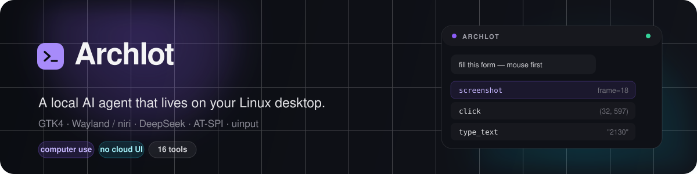
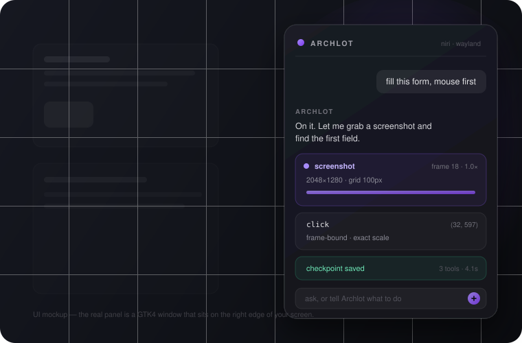
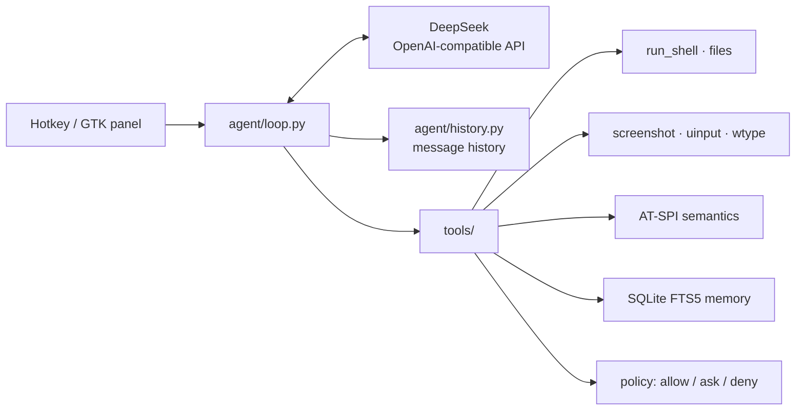

<div align="center">



<br>

**A local AI agent that lives on your Linux desktop.**

Not another chat tab. A GTK4 side panel that can see the screen, move the mouse,
type, run commands, and remember how you work.

<br>

[](https://www.python.org/)
[](https://gtk.org/)
[](https://github.com/YaLTeR/niri)
[](https://www.deepseek.com/)
[](LICENSE)
[](https://github.com/cmdCQ/archlot/actions/workflows/ci.yml)

[简体中文](README.md) · **English**

</div>

---

## Why Archlot?

Most "computer use" agents are a browser automation script with a chat box on top.
Archlot is built the other way around: **the desktop is the interface**.

- **Semantic first, pixels second.** If an app exposes an AT-SPI accessibility tree,
  Archlot reads roles, names, values and actions directly. No guessing coordinates.
- **Pixels when semantics are missing.** For apps without a tree, it takes a screenshot,
  overlays a 100 px grid, and every click is bound to a specific screenshot frame.
  Coordinates are converted with floating-point math, then sent through an absolute
  `uinput` virtual mouse — measured error is under **0.5 px**.
- **Keyboard for the boring parts.** Text fields, Tab order, hotkeys, shell commands.
  The agent picks the cheapest reliable path instead of clicking every pixel.

> The coordinate path is not vibes: screenshot pixels → logical screen → `uinput`
> absolute values is one tested function, with measured error under **0.5 px** on a
> 2048×1280 niri session. See [`tests/test_coords.py`](tests/test_coords.py).

### How it compares

| | Browser-only agents | Cloud computer-use | **Archlot** |
|---|---|---|---|
| Scope | one browser tab | a remote VM | your whole desktop |
| Runs on | your machine or vendor cloud | vendor cloud | your session, locally |
| Precision | DOM selectors | screenshot guessing | AT-SPI first, frame-bound pixels |
| Memory | per session | vendor-side | local SQLite FTS5 |

<div align="center">

</div>

## What it can do

| | |
|---|---|
| **See** | Screenshots with a coordinate grid, window list, AT-SPI accessibility snapshots |
| **Act** | Absolute mouse clicks, scrolling, typing, real keycodes, window focus |
| **Operate** | Shell commands, read/write files, browse directories |
| **Remember** | SQLite FTS5 long-term memory: preferences, environment, projects, lessons |
| **Stay bounded** | Per-turn step and time budgets; dangerous commands require confirmation |
| **Stay readable** | Four small layers, one-way dependencies, stdlib `unittest` only |

## Architecture



```
archlot.py        entry point + wiring only
core/             config, contracts, system, LLM, memory — knows no UI
agent/            turn loop, history, prompts, adaptive effort
tools/            shell, files, desktop, AT-SPI, devices, policy, schemas
ui/               the only place that imports GTK
```

Dependencies point one way: `archlot.py → agent / tools / ui → core`.
`agent/`, `tools/` and `ui/` never import each other.

## Install

Archlot is developed on **Arch Linux + niri (Wayland)**. Other Wayland compositors
may work, but niri is the tested target.

```bash
# System dependencies
sudo pacman -S --needed python-gobject gtk4 at-spi2-core grim wtype wl-clipboard ffmpeg

# /dev/uinput access for the virtual mouse; log out and back in after this
sudo usermod -aG input "$USER"
```

User-level install, no sudo:

```bash
git clone https://github.com/cmdCQ/archlot.git
cd archlot
./install.sh
```

The installer puts the app in `~/.local/share/archlot`, creates `archlot` and
`archlot-setup` in `~/.local/bin`, adds a desktop entry and icon, then offers to open
the graphical setup wizard inside Archlot (`--no-setup` skips it).

Uninstall removes only what it installed:

```bash
./uninstall.sh          # keep config and memory
./uninstall.sh --purge  # also remove config, memory and logs
```

Arch package:

```bash
cd packaging && makepkg -si   # archlot-git
```

Installed paths, updates and troubleshooting: [`docs/install.md`](docs/install.md).

You can also run straight from the checkout:

```bash
bin/archlot              # show the panel
bin/archlot --toggle     # show / hide
bin/archlot --daemon     # stay resident without showing
```

## First-run setup

The first launch opens the setup wizard inside the Archlot panel. You can reopen it
at any time:

```bash
archlot --setup          # installed
bin/archlot --setup      # straight from the checkout
```

This is Archlot's own UI, not a terminal questionnaire and not a separate system
dialog:

1. **Quick start**: what it can do (see / act / operate / remember), basic keys,
   and how appearance customization works
2. **Model**: API base, key, model, workspace; saved to
   `~/.config/archlot/config.json` (mode 600) and applied immediately
3. **Appearance**: presets, opacity, radius, font scale, accent, noise and blur
   toggles with live preview; save the current look as the default or as named
   profiles such as `work` and `night`
4. **Copilot key**: generate and write the niri config; it skips files that already
   declare Archlot and backs up `config.kdl` before writing
5. **Done**: start using it

Click the **⚙** at the right of the header to reopen the wizard. On a headless
session, the terminal wizard remains available as a fallback:

```bash
archlot-setup                    # installed; use bin/archlot-setup from a checkout
bin/archlot-setup --only tutorial
bin/archlot-setup --only model
bin/archlot-setup --only appearance
bin/archlot-setup --only hotkey
```

## Model configuration

`archlot --setup` (or `bin/archlot --setup` from the checkout) walks you through it. You can also edit
`~/.config/archlot/config.json` by hand (any OpenAI-compatible endpoint; DeepSeek
by default):

```bash
cp config.example.json ~/.config/archlot/config.json
chmod 600 ~/.config/archlot/config.json
```

```json
{
  "api_base": "https://api.deepseek.com",
  "api_key": "sk-your-key",
  "model": "deepseek-flash",
  "max_tokens": 16384,
  "workspace": "~/archlot-workspace"
}
```

| Field | Meaning |
|---|---|
| `api_base` | OpenAI-compatible endpoint. Switch providers (OpenAI, OpenRouter, local vLLM…) by changing this and `model` |
| `api_key` | Model key; if empty, `DEEPSEEK_API_KEY` is used |
| `model` | Model name |
| `max_tokens` | Per-reply limit, default 16384 |
| `workspace` | Shell cwd and default directory for file tools |
| `sound_effects` | Play notification sounds, default `true` |
| `confirm_mode` | `auto` confirms dangerous actions only; `strict` also confirms writes outside the workspace |
| `max_steps` / `max_turn_seconds` | Per-turn budget, default 600 steps / 600 s |
| `adaptive_effort` | Adaptive reasoning effort, off by default; the current level is shown when enabled |

Restart Archlot after editing. The key stays on your machine; only model requests leave it.

## Basic usage

| Action | What it does |
|---|---|
| `Enter` | Send the current input |
| `Ctrl+L` | **Clear the context**: resets the conversation and messages; long-term memory is kept |
| `Escape` | Cancel a running task, reject a confirmation dialog, or hide the panel |
| `bin/archlot --toggle` | Show / hide |
| `bin/archlot --setup` | Open the in-panel setup wizard |
| `bin/archlot --daemon` | Stay resident without showing |

Drag the header to move the panel. To let Archlot change itself, just ask —
"move left a bit", "set opacity to 0.7", "try a warm theme" — and it calls the
`panel` / `appearance` tools.

**Saving and restoring looks**

- "Save this look as the default" → the current style becomes your default
- "Save this look as work" → named profile; keep as many as you like
- "Restore the default look" → one-step recovery
- "Switch to work" → apply a named profile
- "Factory reset the look" → `reset`; saved defaults are untouched

Defaults and profiles live in `~/.config/archlot/appearance.json`.

## Summon it with the Copilot key

The setup wizard can generate and write this for you (it backs up the niri
config first). To do it by hand: on many laptops the Copilot key reports as
`XF86TouchpadOff` under Wayland. niri matches the base-layer symbol, so bind
`Mod+Shift+XF86TouchpadOff` to a small wrapper:

```bash
# ~/.local/bin/ai
#!/usr/bin/env bash
exec "$HOME/projects/archlot/bin/archlot" --toggle
```

```kdl
// ~/.config/niri/config.kdl
binds {
    Mod+Shift+XF86TouchpadOff repeat=false hotkey-overlay-title="AI assistant" {
        spawn "/home/yourname/.local/bin/ai";
    }
}
```

`--toggle` is single-instance: it wakes the resident panel, and pressing it again
hides it. To turn Archlot into a frosted floating panel in the top-right corner
(rounded clipping + background blur), see [niri integration](docs/niri.md).

## niri integration

Archlot controls its own opacity through CSS; niri only handles placement, corner
clipping and blur. `appearance(action="niri")` prints a window-rule for the current
look — paste it into `~/.config/niri/config.kdl`. Blur requires niri 26.04+.
**Do not add `opacity` to the niri rule**: it multiplies with the CSS alpha.
Full guide: [`docs/niri.md`](docs/niri.md); copy-paste snippet:
[`examples/niri-archlot.kdl`](examples/niri-archlot.kdl).

## Try asking

```text
Find the invoice PDF in my downloads and summarize the totals.
Open the settings app and turn on night light.
Look at this web form and fill it with my details. Use the mouse first.
Why is my laptop fan loud? Check sensors and processes, then explain.
Write a script that renames these photos by date, then run it.
```

## Toolbox

| Tool | What it does |
|---|---|
| `screenshot` | Capture the screen, attach a coordinate grid, return a frame id |
| `ui` | AT-SPI snapshot and semantic actions: click, set text, select, read, focus |
| `list_windows` | List windows and their geometry |
| `focus_window` | Focus a window by id |
| `click` | Click in screenshot-frame coordinates |
| `move_mouse` | Move the absolute pointer |
| `scroll` | Scroll vertically or horizontally |
| `type_text` | Type text, including real-keycode mode for stubborn UIs |
| `press_key` | Send key chords / named keys |
| `panel` | Move, resize, dock, fade or hide Archlot's own panel |
| `appearance` | Restyle Archlot: colors, opacity, radius, font scale, blur; presets; save/restore looks; niri rule |
| `run_shell` | Run a shell command in the workspace |
| `read_file` | Read a text file |
| `write_file` | Write a text file |
| `list_dir` | List a directory |
| `memory` | Add, search or forget long-term memories |

## Safety model

- **One policy source.** `tools/policy.py` classifies every action as allow, ask or deny.
  Dangerous commands (`sudo`, `mkfs`, `dd`, shutdown, package removal, deleting system
  directories) always open a confirmation dialog.
- **Structured results.** Tools return a `ToolResult` with an error kind
  (`bad_args`, `denied`, `exception`, `not_found`, `stale_frame`, ...). Denied and failed
  are different things and are handled differently.
- **Bounded autonomy.** A turn stops at `max_steps` and `max_turn_seconds` (600 / 600 s
  by default), and every tool call has its own timeout.
- **No hidden knobs.** Adaptive reasoning effort is off by default. When enabled, the
  current level is shown in the status bar and every change is logged.
- **Your key stays local.** The API key lives in `~/.config/archlot/config.json` or
  `DEEPSEEK_API_KEY`. Only the model request leaves the machine; the UI and all desktop
  actions are local.

## Design principles

1. **Small layers, hard boundaries.** GTK only in `ui/`; `core/` knows nothing above it.
2. **One source of truth per concern.** Policy in `policy.py`, history in `history.py`,
   coordinates in one conversion function.
3. **Semantic before pixel.** Accessibility trees beat guessed coordinates; coordinates
   beat nothing.
4. **Every action is auditable.** Structured results, frame ids, and logs in
   `/tmp/archlot-app.log`.
5. **No framework for its own sake.** No event bus, no DI container, no provider
   abstraction layer.

## Status & roadmap

Archlot is usable daily and under active development. Known limits:

- Built and tested on niri; GNOME/KDE/Sway are not yet validated.
- AT-SPI coverage depends on the application. Some apps expose little or nothing.
- Screenshot coordinate estimates still have human-like error on very small controls.
  The next step is zoomed region screenshots that give the model a magnified view.
- UI copy is currently Chinese; the agent answers in Chinese by default.

Roadmap: zoomable screenshot crops, a click-precision regression suite, broader
compositor support, and more semantic adapters for common apps.

## Contributing

Read [`AGENT.md`](AGENT.md) first — it is the single source of truth for code rules.
[`CONTRIBUTING.md`](CONTRIBUTING.md) covers setup and pull-request expectations;
security reports go through [`SECURITY.md`](SECURITY.md). Then:

```bash
python -m compileall -q core agent tools ui archlot.py
python -m unittest discover -s tests -t .
```

No pytest, no ruff, no new top-level packages. Keep the dependency direction intact.

## License

[MIT](LICENSE)

---

<div align="center">

**If Archlot saves you a click — or a hundred — a star helps other people find it.**

</div>
