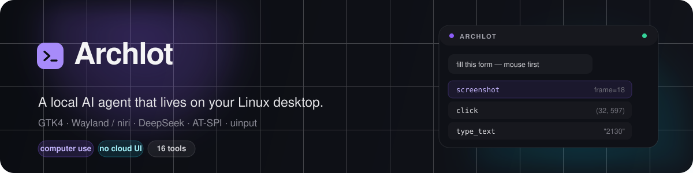
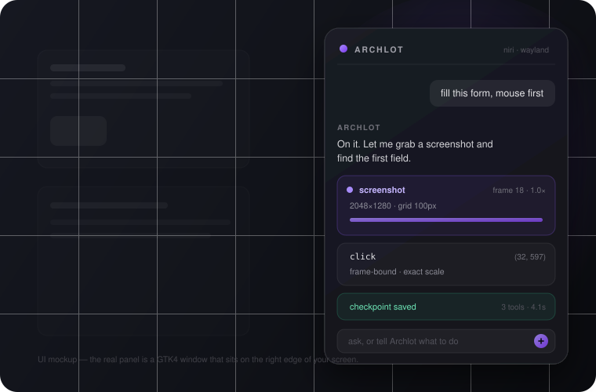
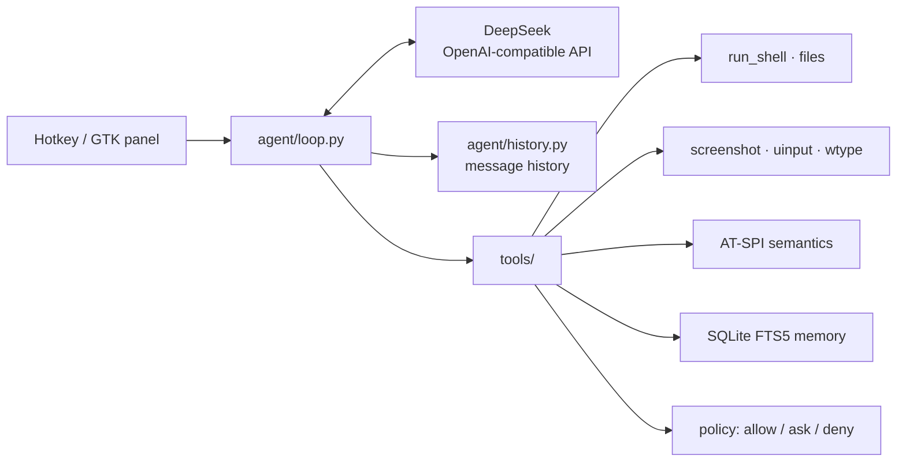

<div align="center">



<br>

**A local AI agent that lives on your Linux desktop.**

Not another chat tab. A GTK4 side panel that can see the screen, move the mouse,
type, run commands, and remember how you work.

<br>

[](https://www.python.org/)
[](https://gtk.org/)
[](https://github.com/YaLTeR/niri)
[](https://www.deepseek.com/)
[](LICENSE)
[](https://github.com/cmdCQ/archlot/actions/workflows/ci.yml)

[English](README.md) · [简体中文](README.zh-CN.md)

</div>

---

## Why Archlot?

Most "computer use" agents are a browser automation script with a chat box on top.
Archlot is built the other way around: **the desktop is the interface**.

- **Semantic first, pixels second.** If an app exposes an AT-SPI accessibility tree,
  Archlot reads roles, names, values and actions directly. No guessing coordinates.
- **Pixels when semantics are missing.** For apps without a tree, it takes a screenshot,
  overlays a 100 px grid, and every click is bound to a specific screenshot frame.
  Coordinates are converted with floating-point math, then sent through an absolute
  `uinput` virtual mouse — measured error is under **0.5 px**.
- **Keyboard for the boring parts.** Text fields, Tab order, hotkeys, shell commands.
  The agent picks the cheapest reliable path instead of clicking every pixel.

> The coordinate path is not vibes: screenshot pixels → logical screen → `uinput`
> absolute values is one tested function, with measured error under **0.5 px** on a
> 2048×1280 niri session. See [`tests/test_coords.py`](tests/test_coords.py).

### How it compares

| | Browser-only agents | Cloud computer-use | **Archlot** |
|---|---|---|---|
| Scope | one browser tab | a remote VM | your whole desktop |
| Runs on | your machine or vendor cloud | vendor cloud | your session, locally |
| Precision | DOM selectors | screenshot guessing | AT-SPI first, frame-bound pixels |
| Memory | per session | vendor-side | local SQLite FTS5 |

<div align="center">

</div>

## What it can do

| | |
|---|---|
| **See** | Screenshots with a coordinate grid, window list, AT-SPI accessibility snapshots |
| **Act** | Absolute mouse clicks, scrolling, typing, real keycodes, window focus |
| **Operate** | Shell commands, read/write files, browse directories |
| **Remember** | SQLite FTS5 long-term memory: preferences, environment, projects, lessons |
| **Stay bounded** | Per-turn step and time budgets; dangerous commands require confirmation |
| **Stay readable** | Four small layers, one-way dependencies, stdlib `unittest` only |

## Architecture



```
archlot.py        entry point + wiring only
core/             config, contracts, system, LLM, memory — knows no UI
agent/            turn loop, history, prompts, adaptive effort
tools/            shell, files, desktop, AT-SPI, devices, policy, schemas
ui/               the only place that imports GTK
```

Dependencies point one way: `archlot.py → agent / tools / ui → core`.
`agent/`, `tools/` and `ui/` never import each other.

## Quick start

Archlot is developed on **Arch Linux + niri (Wayland)**. Other Wayland compositors
may work, but niri is the tested target.

```bash
# 1. System dependencies
sudo pacman -S --needed python-gobject gtk4 at-spi2-core grim wtype wl-clipboard ffmpeg

# 2. /dev/uinput access for the virtual mouse
sudo usermod -aG input "$USER"
# log out and back in after this

# 3. Clone and configure
git clone https://github.com/cmdCQ/archlot.git
cd archlot
mkdir -p ~/.config/archlot
cp config.example.json ~/.config/archlot/config.json
chmod 600 ~/.config/archlot/config.json
# put your DeepSeek key in api_key, or export DEEPSEEK_API_KEY

# 4. Run
bin/archlot              # show the panel
bin/archlot --toggle     # show / hide
bin/archlot --daemon     # stay resident without showing
```

Bind it to a key (niri example):

```kdl
binds {
    Mod+Space repeat=false { spawn "~/projects/archlot/bin/archlot" "--toggle"; }
}
```

> **Accessibility note:** semantic mode uses AT-SPI. If your session has
> `org.a11y.Status.IsEnabled=false`, Archlot falls back to screenshots and tells you
> why. For Firefox, enabling `accessibility.force_enabled` gives it a full tree.

## Try asking

```text
Find the invoice PDF in my downloads and summarize the totals.
Open the settings app and turn on night light.
Look at this web form and fill it with my details. Use the mouse first.
Why is my laptop fan loud? Check sensors and processes, then explain.
Write a script that renames these photos by date, then run it.
```

## Toolbox

| Tool | What it does |
|---|---|
| `screenshot` | Capture the screen, attach a coordinate grid, return a frame id |
| `ui` | AT-SPI snapshot and semantic actions: click, set text, select, read, focus |
| `list_windows` | List windows and their geometry |
| `focus_window` | Focus a window by id |
| `click` | Click in screenshot-frame coordinates |
| `move_mouse` | Move the absolute pointer |
| `scroll` | Scroll vertically or horizontally |
| `type_text` | Type text, including real-keycode mode for stubborn UIs |
| `press_key` | Send key chords / named keys |
| `panel` | Move, resize, dock, fade or hide Archlot's own panel |
| `run_shell` | Run a shell command in the workspace |
| `read_file` | Read a text file |
| `write_file` | Write a text file |
| `list_dir` | List a directory |
| `memory` | Add, search or forget long-term memories |

## Safety model

- **One policy source.** `tools/policy.py` classifies every action as allow, ask or deny.
  Dangerous commands (`sudo`, `mkfs`, `dd`, shutdown, package removal, deleting system
  directories) always open a confirmation dialog.
- **Structured results.** Tools return a `ToolResult` with an error kind
  (`bad_args`, `denied`, `exception`, `not_found`, `stale_frame`, ...). Denied and failed
  are different things and are handled differently.
- **Bounded autonomy.** A turn stops at `max_steps` and `max_turn_seconds` (600 / 600 s
  by default), and every tool call has its own timeout.
- **No hidden knobs.** Adaptive reasoning effort is off by default. When enabled, the
  current level is shown in the status bar and every change is logged.
- **Your key stays local.** The API key lives in `~/.config/archlot/config.json` or
  `DEEPSEEK_API_KEY`. Only the model request leaves the machine; the UI and all desktop
  actions are local.

## Design principles

1. **Small layers, hard boundaries.** GTK only in `ui/`; `core/` knows nothing above it.
2. **One source of truth per concern.** Policy in `policy.py`, history in `history.py`,
   coordinates in one conversion function.
3. **Semantic before pixel.** Accessibility trees beat guessed coordinates; coordinates
   beat nothing.
4. **Every action is auditable.** Structured results, frame ids, and logs in
   `/tmp/archlot-app.log`.
5. **No framework for its own sake.** No event bus, no DI container, no provider
   abstraction layer.

## Status & roadmap

Archlot is usable daily and under active development. Known limits:

- Built and tested on niri; GNOME/KDE/Sway are not yet validated.
- AT-SPI coverage depends on the application. Some apps expose little or nothing.
- Screenshot coordinate estimates still have human-like error on very small controls.
  The next step is zoomed region screenshots that give the model a magnified view.
- UI copy is currently Chinese; the agent answers in Chinese by default.

Roadmap: zoomable screenshot crops, a click-precision regression suite, broader
compositor support, and more semantic adapters for common apps.

## Contributing

Read [`AGENT.md`](AGENT.md) first — it is the single source of truth for code rules.
[`CONTRIBUTING.md`](CONTRIBUTING.md) covers setup and pull-request expectations;
security reports go through [`SECURITY.md`](SECURITY.md). Then:

```bash
python -m compileall -q core agent tools ui archlot.py
python -m unittest discover -s tests -t .
```

No pytest, no ruff, no new top-level packages. Keep the dependency direction intact.

## License

[MIT](LICENSE)

---

<div align="center">

**If Archlot saves you a click — or a hundred — a star helps other people find it.**

</div>
