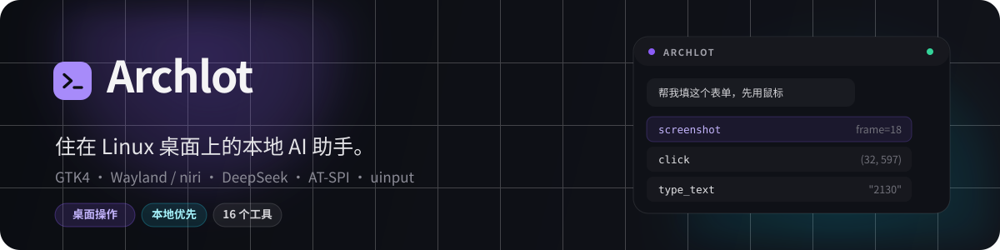
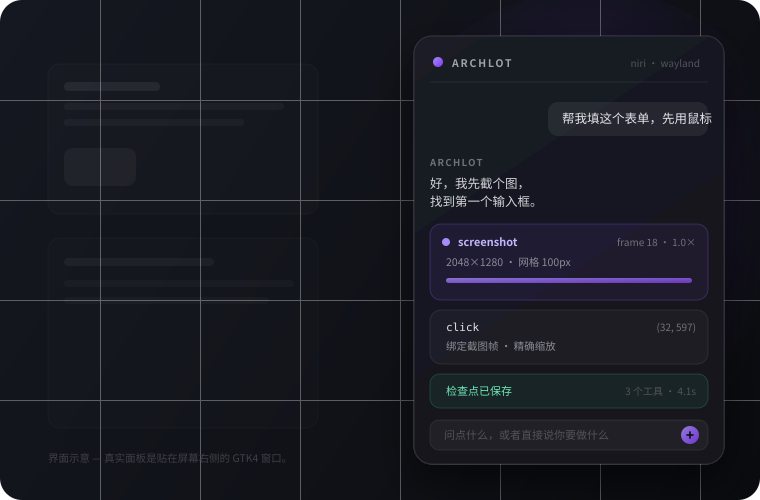
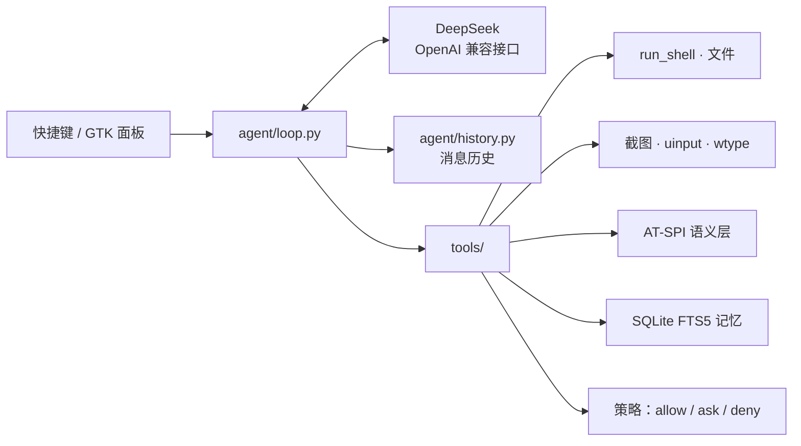

<div align="center">



<br>

**住在 Linux 桌面上的本地 AI 助手。**

不是网页里的聊天框，而是一块 GTK4 侧栏：能看屏幕、动鼠标、敲键盘、跑命令，
还会记住你的习惯和踩过的坑。

<br>

[](https://www.python.org/)
[](https://gtk.org/)
[](https://github.com/YaLTeR/niri)
[](https://www.deepseek.com/)
[](LICENSE)
[](https://github.com/cmdCQ/archlot/actions/workflows/ci.yml)

**简体中文** · [English](README.en.md)

</div>

---

## 为什么是 Archlot？

大多数 “computer use” 项目本质上是浏览器自动化脚本加一个聊天框。
Archlot 反过来：**桌面才是界面**。

- **先语义，后像素。** 应用暴露了 AT-SPI 可访问性树时，直接读角色、名称、值和动作，
  不猜坐标。
- **没有树再截图。** 截图会叠加 100px 网格，每次点击都绑定到具体截图帧；
  坐标用浮点换算后交给绝对坐标 `uinput` 虚拟鼠标，实测误差小于 **0.5px**。
- **能用键盘就不点。** 文本框、Tab 顺序、快捷键、shell 命令——
  选最省事又可靠的路径，而不是每个像素都点一遍。

> 坐标不是拍脑袋：从截图像素 → 逻辑屏幕 → `uinput` 绝对值，只有一个经过测试的换算函数。
> 在 2048×1280 的 niri 会话上实测误差小于 **0.5px**，见
> [`tests/test_coords.py`](tests/test_coords.py)。

### 和其他方案的区别

| | 只做浏览器的 agent | 云端 computer-use | **Archlot** |
|---|---|---|---|
| 范围 | 一个浏览器标签页 | 一台远程虚拟机 | 整个桌面 |
| 运行位置 | 本机或厂商云 | 厂商云 | 本机会话 |
| 精度 | DOM 选择器 | 猜截图坐标 | AT-SPI 优先，点击绑定截图帧 |
| 记忆 | 单次会话 | 厂商侧 | 本地 SQLite FTS5 |

<div align="center">

</div>

## 能做什么

| | |
|---|---|
| **看** | 带坐标网格的截图、窗口列表、AT-SPI 可访问性快照 |
| **动** | 绝对坐标鼠标点击、滚动、输入、真实键码、窗口聚焦 |
| **操作** | 执行 shell、读写文件、浏览目录 |
| **记住** | SQLite FTS5 长期记忆：偏好、环境、项目、经验 |
| **有边界** | 每轮步数和时间预算；危险命令必须确认 |
| **可维护** | 四层小架构、单向依赖、只用标准库 `unittest` |

## 架构



```
archlot.py        入口，只做接线
core/             配置、契约、系统、LLM、记忆——不认识界面
agent/            轮次循环、历史、提示词、自适应思考强度
tools/            shell、文件、桌面、AT-SPI、输入设备、策略、schema
ui/               唯一允许 import GTK 的地方
```

依赖只能向下：`archlot.py → agent / tools / ui → core`。
`agent/`、`tools/`、`ui/` 互不 import。

## 安装

Archlot 在 **Arch Linux + niri（Wayland）** 上开发和测试。
其他 Wayland 合成器可能可用，但 niri 是当前验证过的目标。

```bash
# 系统依赖
sudo pacman -S --needed python-gobject gtk4 at-spi2-core grim wtype wl-clipboard ffmpeg

# 虚拟鼠标需要 /dev/uinput 权限，改完重新登录
sudo usermod -aG input "$USER"
```

用户级安装，不需要 sudo：

```bash
git clone https://github.com/cmdCQ/archlot.git
cd archlot
./install.sh
```

安装脚本会：

- 把程序装到 `~/.local/share/archlot`
- 在 `~/.local/bin` 放 `archlot` 和 `archlot-setup`
- 添加桌面入口和图标
- 询问是否立即打开面板里的图形配置向导（`--no-setup` 可跳过）

卸载只会删除自己装的文件：

```bash
./uninstall.sh          # 保留配置和记忆
./uninstall.sh --purge  # 连配置、记忆、日志一起删
```

想用 Arch 包：

```bash
cd packaging && makepkg -si   # archlot-git
```

安装路径、更新方式和排错见 [`docs/install.md`](docs/install.md)。

不用安装脚本也可以直接在仓库里跑：

```bash
bin/archlot              # 显示面板
bin/archlot --toggle     # 显示 / 收起
bin/archlot --daemon     # 只驻留，不显示
```

## 第一次配置

第一次启动会自动在 Archlot 面板里打开配置向导；装好以后也可以随时运行：

```bash
archlot --setup          # 已安装
bin/archlot --setup      # 直接跑源码
```

向导就是 Archlot 自己的界面，不是终端问答，也不会弹出别的窗口：

1. **快速上手**：功能展示（看 / 动 / 干 / 记）、基本按键，以及外观怎么改
2. **模型**：API 地址、key、模型名、工作区；写入
   `~/.config/archlot/config.json`（权限 600），保存后立即生效
3. **外观**：预设、透明度、圆角、字号、主色、噪点、模糊开关实时预览；
   可以把当前样子存为默认，也可以存成 `work`、`night` 等命名配置
4. **Copilot 键**：生成并写入 niri 配置；已有 Archlot 规则时不会重复写，
   写入前自动备份 `config.kdl`
5. **完成**：直接开始用

之后点标题栏右侧的 **⚙** 可以随时重新打开向导。没有图形会话时，
终端向导仍可作为备用：

```bash
archlot-setup                    # 已安装；源码目录用 bin/archlot-setup
bin/archlot-setup --only tutorial
bin/archlot-setup --only model
bin/archlot-setup --only appearance
bin/archlot-setup --only hotkey
```

## 配置模型

运行 `archlot --setup`（源码目录 `bin/archlot --setup`）会引导你填好。也可以手动改
`~/.config/archlot/config.json`（OpenAI 兼容接口，默认接 DeepSeek）：

```bash
cp config.example.json ~/.config/archlot/config.json
chmod 600 ~/.config/archlot/config.json
```

```json
{
  "api_base": "https://api.deepseek.com",
  "api_key": "sk-你的 key",
  "model": "deepseek-flash",
  "max_tokens": 16384,
  "workspace": "~/archlot-workspace"
}
```

| 字段 | 说明 |
|---|---|
| `api_base` | OpenAI 兼容端点。换厂商（OpenAI、OpenRouter、本地 vLLM…）只改这里和 `model` |
| `api_key` | 模型 key；留空则读环境变量 `DEEPSEEK_API_KEY` |
| `model` | 模型名 |
| `max_tokens` | 单次回复上限，默认 16384 |
| `workspace` | shell 的 cwd，也是文件工具的默认目录 |
| `sound_effects` | 是否播放提示音，默认 `true` |
| `confirm_mode` | `auto` 只对危险动作弹确认；`strict` 工作区外写入也确认 |
| `max_steps` / `max_turn_seconds` | 每轮预算，默认 600 步 / 600 秒 |
| `adaptive_effort` | 自适应思考强度，默认关闭；开启后状态栏显示当前档位 |

改完重启 Archlot 生效。key 只留在本机，只有模型请求会离开。

## 基本用法

| 操作 | 行为 |
|---|---|
| `Enter` | 发送当前输入 |
| `Ctrl+L` | **清空上下文**：重置本轮会话和消息列表，长期记忆保留 |
| `Escape` | 有任务在跑就取消；有确认框就拒绝；否则收起面板 |
| `bin/archlot --toggle` | 唤出 / 收起 |
| `bin/archlot --setup` | 打开面板内配置向导 |
| `bin/archlot --daemon` | 只驻留，不显示 |

面板可拖标题栏移动。想让它自己改位置、尺寸、透明度，直接说
“往左一点”“透明到 0.7”“换个暖色”，它会调用 `panel` / `appearance` 工具。

**外观的保存与恢复**

- “把现在的外观存成默认” → 当前样式成为默认外观
- “把外观存成 work” → 命名保存，可以存多套（`night`、`work`、`demo`…）
- “恢复默认外观” → 一键回到保存的默认外观
- “换成 work” → 套用命名配置
- “恢复出厂外观” → `reset`，只改当前，不动已保存的默认

默认外观和命名配置存在 `~/.config/archlot/appearance.json`。

## 用 Copilot 键召唤

向导第 4 步（或 ⚙ → 快捷键）可以自动生成并写入下面这段（写入前会备份 niri 配置）。
手动配置时：很多笔记本上的 Copilot 键在 Wayland 里报告为 `XF86TouchpadOff`。
niri 按基础层符号匹配，这台机器上实测绑定写成
`Mod+Shift+XF86TouchpadOff`，指向一个包装脚本：

```bash
# ~/.local/bin/ai
#!/usr/bin/env bash
exec "$HOME/projects/archlot/bin/archlot" --toggle
```

```kdl
// ~/.config/niri/config.kdl
binds {
    Mod+Shift+XF86TouchpadOff repeat=false hotkey-overlay-title="AI 助手" {
        spawn "/home/你的用户名/.local/bin/ai";
    }
}
```

`--toggle` 是单实例：已经在后台驻留就唤出，再按一次收起。要把 Archlot 变成
右上角的磨砂浮窗（圆角裁剪 + 背景模糊），见 [niri 集成](docs/niri.md)。

## niri 集成

Archlot 的透明度由自己的 CSS 控制，niri 只负责窗口位置、圆角裁剪和模糊。
`appearance(action="niri")` 会按当前外观生成 window-rule，直接贴进
`~/.config/niri/config.kdl`。模糊需要 niri 26.04+；**不要在 niri 规则里再写
`opacity`**，两边会叠乘。完整配置和预设说明见 [`docs/niri.md`](docs/niri.md)，
可复制的片段见 [`examples/niri-archlot.kdl`](examples/niri-archlot.kdl)。

## 可以这样用

```text
把我下载目录里的发票 PDF 找出来，把金额合计一下。
打开设置，把夜间模式打开。
看着这个网页表单，用鼠标帮我填一下。
笔记本风扇为什么一直响？查一下传感器和进程再告诉我。
写个脚本把工作区里的照片按日期改名，然后直接运行。
```

## 工具

| 工具 | 作用 |
|---|---|
| `screenshot` | 截屏，叠加坐标网格，返回 frame 编号 |
| `ui` | AT-SPI 快照与语义动作：click、set_text、select、read、focus |
| `list_windows` | 列出窗口和几何信息 |
| `focus_window` | 按 id 聚焦窗口 |
| `click` | 按截图帧坐标点击 |
| `move_mouse` | 移动绝对坐标鼠标 |
| `scroll` | 纵向 / 横向滚动 |
| `type_text` | 输入文字，支持真实键码模式 |
| `press_key` | 发送组合键 / 命名键 |
| `panel` | 移动、缩放、贴边、淡化或隐藏 Archlot 自己的面板 |
| `appearance` | 改颜色、透明度、圆角、字号、模糊；套预设；保存 / 恢复外观配置；生成 niri 规则 |
| `run_shell` | 在工作区执行 shell 命令 |
| `read_file` | 读取文本文件 |
| `write_file` | 写入文本文件 |
| `list_dir` | 列出目录 |
| `memory` | 添加、检索、忘掉长期记忆 |

## 安全模型

- **策略只有一个源。** `tools/policy.py` 把动作分成 allow / ask / deny。
  `sudo`、`mkfs`、`dd`、关机、卸载包、删系统目录等危险命令一律弹确认。
- **结果结构化。** 每个工具返回 `ToolResult`，带 `error_kind`
  （`bad_args`、`denied`、`exception`、`not_found`、`stale_frame`……）。
  “被拒绝”和“执行失败”是两件事。
- **自主有预算。** 每轮最多 `max_steps` 步、`max_turn_seconds` 秒（默认 600 / 600），
  单次工具调用也有超时。
- **没有隐藏旋钮。** 自适应思考强度默认关闭；开启后状态栏会显示当前档位，
  每次变化都写日志。
- **Key 留在本地。** API key 存在 `~/.config/archlot/config.json` 或
  `DEEPSEEK_API_KEY`。只有模型请求会离开本机，界面和所有桌面动作都在本地。

## 设计原则

1. **层小，边界硬。** GTK 只在 `ui/`；`core/` 不知道上层存在。
2. **每件事只有一个源。** 策略在 `policy.py`，历史在 `history.py`，
   坐标换算只有一个函数。
3. **语义优先于像素。** 可访问性树比猜坐标稳；猜坐标比什么都不做强。
4. **每个动作可审计。** 结构化结果、frame 编号、日志在 `/tmp/archlot-app.log`。
5. **不为抽象而抽象。** 没有事件总线、没有 DI 容器、没有 provider 适配层。

## 状态与路线

Archlot 已经可以日常使用，但仍在开发中。已知限制：

- 只在 niri 上验证过；GNOME / KDE / Sway 还没测。
- AT-SPI 覆盖取决于应用，有些应用几乎不暴露树。
- 截图坐标估计对很小的控件仍会有人类式的误差。下一步是做**局部放大截图**，
  让模型看清目标再点。
- 界面文案目前是中文，助手默认也用中文回答。

路线：局部放大截图、点击精度回归测试、更多合成器支持、常见应用的语义适配。

## 参与开发

先读 [`AGENT.md`](AGENT.md)——它是代码规则的唯一来源。
开发环境和 PR 约定见 [`CONTRIBUTING.md`](CONTRIBUTING.md)，
安全问题走 [`SECURITY.md`](SECURITY.md)。然后：

```bash
python -m compileall -q core agent tools ui archlot.py
python -m unittest discover -s tests -t .
```

不要引入 pytest、ruff 或新的顶层包，保持依赖方向不变。

## License

[MIT](LICENSE)

---

<div align="center">

**如果 Archlot 帮你少点了哪怕一百次鼠标，点个 star 让更多人看到它。**

</div>
