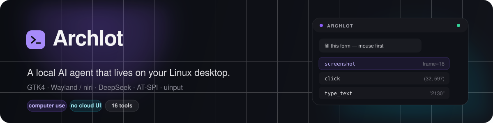
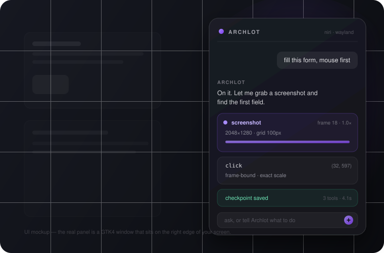
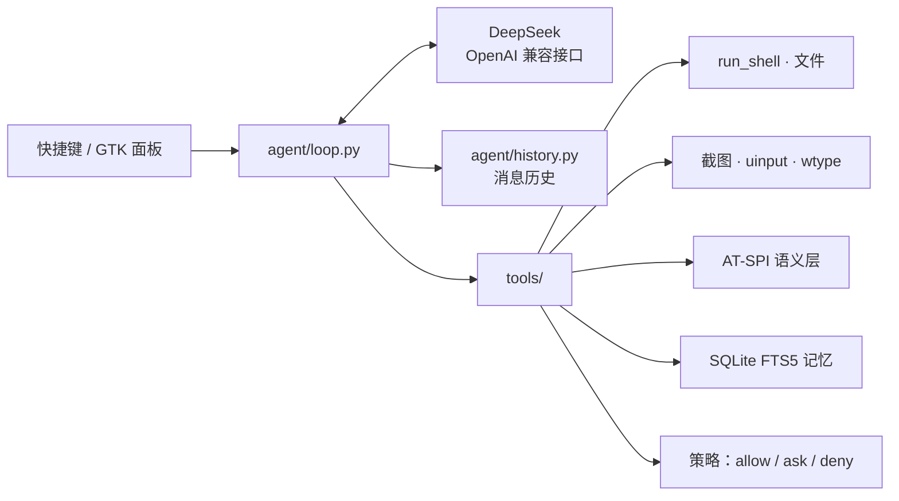

<div align="center">



<br>

**住在 Linux 桌面上的本地 AI 助手。**

不是网页里的聊天框，而是一块 GTK4 侧栏：能看屏幕、动鼠标、敲键盘、跑命令，
还会记住你的习惯和踩过的坑。

<br>

[](https://www.python.org/)
[](https://gtk.org/)
[](https://github.com/YaLTeR/niri)
[](https://www.deepseek.com/)
[](LICENSE)
[](https://github.com/cmdCQ/archlot/actions/workflows/ci.yml)

[English](README.md) · **简体中文**

</div>

---

## 为什么是 Archlot？

大多数 “computer use” 项目本质上是浏览器自动化脚本加一个聊天框。
Archlot 反过来：**桌面才是界面**。

- **先语义，后像素。** 应用暴露了 AT-SPI 可访问性树时，直接读角色、名称、值和动作，
  不猜坐标。
- **没有树再截图。** 截图会叠加 100px 网格，每次点击都绑定到具体截图帧；
  坐标用浮点换算后交给绝对坐标 `uinput` 虚拟鼠标，实测误差小于 **0.5px**。
- **能用键盘就不点。** 文本框、Tab 顺序、快捷键、shell 命令——
  选最省事又可靠的路径，而不是每个像素都点一遍。

<div align="center">

</div>

## 能做什么

| | |
|---|---|
| **看** | 带坐标网格的截图、窗口列表、AT-SPI 可访问性快照 |
| **动** | 绝对坐标鼠标点击、滚动、输入、真实键码、窗口聚焦 |
| **操作** | 执行 shell、读写文件、浏览目录 |
| **记住** | SQLite FTS5 长期记忆：偏好、环境、项目、经验 |
| **有边界** | 每轮步数和时间预算；危险命令必须确认 |
| **可维护** | 四层小架构、单向依赖、只用标准库 `unittest` |

## 架构



```
archlot.py        入口，只做接线
core/             配置、契约、系统、LLM、记忆——不认识界面
agent/            轮次循环、历史、提示词、自适应思考强度
tools/            shell、文件、桌面、AT-SPI、输入设备、策略、schema
ui/               唯一允许 import GTK 的地方
```

依赖只能向下：`archlot.py → agent / tools / ui → core`。
`agent/`、`tools/`、`ui/` 互不 import。

## 快速开始

Archlot 在 **Arch Linux + niri（Wayland）** 上开发和测试。
其他 Wayland 合成器可能可用，但 niri 是当前验证过的目标。

```bash
# 1. 系统依赖
sudo pacman -S --needed python-gobject gtk4 at-spi2-core grim wtype wl-clipboard ffmpeg

# 2. 给虚拟鼠标 /dev/uinput 权限
sudo usermod -aG input "$USER"
# 改完重新登录

# 3. 克隆并配置
git clone https://github.com/cmdCQ/archlot.git
cd archlot
mkdir -p ~/.config/archlot
cp config.example.json ~/.config/archlot/config.json
chmod 600 ~/.config/archlot/config.json
# 把 DeepSeek key 填进 api_key，或者 export DEEPSEEK_API_KEY

# 4. 运行
bin/archlot              # 显示面板
bin/archlot --toggle     # 显示 / 收起
bin/archlot --daemon     # 只驻留，不显示
```

绑到快捷键（niri 示例）：

```kdl
binds {
    Mod+Space repeat=false { spawn "~/projects/archlot/bin/archlot" "--toggle"; }
}
```

> **可访问性说明：** 语义模式依赖 AT-SPI。如果会话里
> `org.a11y.Status.IsEnabled=false`，Archlot 会明确告诉你，并退回截图模式。
> Firefox 需要打开 `accessibility.force_enabled` 才会暴露完整的可访问性树。

## 可以这样用

```text
把我下载目录里的发票 PDF 找出来，把金额合计一下。
打开设置，把夜间模式打开。
看着这个网页表单，用鼠标帮我填一下。
笔记本风扇为什么一直响？查一下传感器和进程再告诉我。
写个脚本把工作区里的照片按日期改名，然后直接运行。
```

## 工具

| 工具 | 作用 |
|---|---|
| `screenshot` | 截屏，叠加坐标网格，返回 frame 编号 |
| `ui` | AT-SPI 快照与语义动作：click、set_text、select、read、focus |
| `list_windows` | 列出窗口和几何信息 |
| `focus_window` | 按 id 聚焦窗口 |
| `click` | 按截图帧坐标点击 |
| `move_mouse` | 移动绝对坐标鼠标 |
| `scroll` | 纵向 / 横向滚动 |
| `type_text` | 输入文字，支持真实键码模式 |
| `press_key` | 发送组合键 / 命名键 |
| `panel` | 移动、缩放、贴边、淡化或隐藏 Archlot 自己的面板 |
| `run_shell` | 在工作区执行 shell 命令 |
| `read_file` | 读取文本文件 |
| `write_file` | 写入文本文件 |
| `list_dir` | 列出目录 |
| `memory` | 添加、检索、忘掉长期记忆 |

## 安全模型

- **策略只有一个源。** `tools/policy.py` 把动作分成 allow / ask / deny。
  `sudo`、`mkfs`、`dd`、关机、卸载包、删系统目录等危险命令一律弹确认。
- **结果结构化。** 每个工具返回 `ToolResult`，带 `error_kind`
  （`bad_args`、`denied`、`exception`、`not_found`、`stale_frame`……）。
  “被拒绝”和“执行失败”是两件事。
- **自主有预算。** 每轮最多 `max_steps` 步、`max_turn_seconds` 秒（默认 600 / 600），
  单次工具调用也有超时。
- **没有隐藏旋钮。** 自适应思考强度默认关闭；开启后状态栏会显示当前档位，
  每次变化都写日志。
- **Key 留在本地。** API key 存在 `~/.config/archlot/config.json` 或
  `DEEPSEEK_API_KEY`。只有模型请求会离开本机，界面和所有桌面动作都在本地。

## 设计原则

1. **层小，边界硬。** GTK 只在 `ui/`；`core/` 不知道上层存在。
2. **每件事只有一个源。** 策略在 `policy.py`，历史在 `history.py`，
   坐标换算只有一个函数。
3. **语义优先于像素。** 可访问性树比猜坐标稳；猜坐标比什么都不做强。
4. **每个动作可审计。** 结构化结果、frame 编号、日志在 `/tmp/archlot-app.log`。
5. **不为抽象而抽象。** 没有事件总线、没有 DI 容器、没有 provider 适配层。

## 状态与路线

Archlot 已经可以日常使用，但仍在开发中。已知限制：

- 只在 niri 上验证过；GNOME / KDE / Sway 还没测。
- AT-SPI 覆盖取决于应用，有些应用几乎不暴露树。
- 截图坐标估计对很小的控件仍会有人类式的误差。下一步是做**局部放大截图**，
  让模型看清目标再点。
- 界面文案目前是中文，助手默认也用中文回答。

路线：局部放大截图、点击精度回归测试、更多合成器支持、常见应用的语义适配。

## 参与开发

先读 [`AGENT.md`](AGENT.md)——它是代码规则的唯一来源。
开发环境和 PR 约定见 [`CONTRIBUTING.md`](CONTRIBUTING.md)，
安全问题走 [`SECURITY.md`](SECURITY.md)。然后：

```bash
python -m compileall -q core agent tools ui archlot.py
python -m unittest discover -s tests -t .
```

不要引入 pytest、ruff 或新的顶层包，保持依赖方向不变。

## License

[MIT](LICENSE)

---

<div align="center">

**如果 Archlot 帮你少点了哪怕一百次鼠标，点个 star 让更多人看到它。**

</div>
